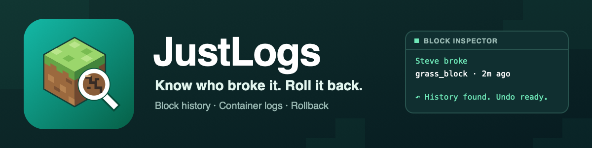

<!--
Popis pro Modrinth (Markdown). Agent: piš ANGLICKY, věcně, podle skutečného kódu.
Povinné sekce: perex (1-2 věty), Features, Commands & Permissions, Configuration, Compatibility, Support.
Žádné vymyšlené funkce. Tato stránka se synchronizuje na Modrinth (Gradle: modrinthSyncBody).
-->
# JustLogs

Block and container logging with an inspector, lookup and rollback. Know who broke, placed, burned, blew up or took what, and put it back.

## Features
- Logs blocks placed and broken by players, water and lava buckets, fire (ignite, burn), explosions, tree growth and block changes by mobs (enderman, farmland trampling).
- Knows who is behind it: fire and TNT are attributed to the player who lit them, otherwise to an honest source such as `#fire`, `#tnt` or `#creeper`.
- Logs items put into and taken out of chests, barrels, shulker boxes, hoppers, furnaces and other containers, including named and enchanted items.
- Free-form search: `u:` player, `t:` time (`2d`, `2d-1d`), `r:` radius, `a:` action or group, `b:` block or item (`#tag` works), `w:` world, `at:` position; `#count` and `#verbose` flags.
- Rollback, restore and undo for blocks and for container items. A broken chest comes back with its contents. Big changes wait for `/jo confirm`, `#preview` shows ghost blocks only to you.
- Changes are applied chunk by chunk within a time budget per tick; the rollback itself is not logged again.
- SQLite out of the box, MariaDB/MySQL for shared databases. Writes are batched on one background thread and never block the server.
- English and Czech messages, a config that updates itself (admin values and comments are kept), optional update check, bStats with an off switch.

## Commands & Permissions
Root command `/justlogs`, short aliases `/jo` and `/jlogs`.

| Command | Permission | Description |
|---|---|---|
| `/justlogs inspect` | `justlogs.inspect` | Inspector mode: left click a block for its history, right click the spot next to it; right click a container for its item history |
| `/justlogs lookup <parameters>` | `justlogs.lookup` | Search the log (aliases `/jo`, `/jlogs`; `/jo l`) |
| `/justlogs near [radius]` | `justlogs.lookup` | Changes around you in the last 3 days |
| `/justlogs page <n>` | `justlogs.lookup` | Another page of the last result |
| `/justlogs rollback <parameters>` | `justlogs.rollback` | Put blocks (or container items with `a:container`) back; needs `t:` and `u:` or `r:`; `#preview` shows it to you first |
| `/justlogs restore <parameters>` | `justlogs.restore` | Apply rolled-back changes again |
| `/justlogs undo` | `justlogs.rollback` | Reverse your last rollback or restore |
| `/justlogs confirm / cancel` | `justlogs.rollback or .restore` | Run or drop a rollback that is waiting for confirmation |
| `/justlogs tp <world> <x> <y> <z>` | `justlogs.teleport` | Target of the clickable coordinates in results |
| `/justlogs status` | `justlogs.status` | Queue, writer, database and rollback state |
| `/justlogs reload` | `justlogs.reload` | Reload config.yml and messages |
| | `justlogs.lookup.container` | Look up container contents |
| | `justlogs.lookup.global` | Search the whole server, radius above the limit |
| | `justlogs.rollback.global` | Roll back without a radius |
| | `justlogs.helper` | Package: look things up, never change anything |
| | `justlogs.admin` | Everything |

Everything is `op` by default.

## Configuration
Everything is in `plugins/JustLogs/config.yml` and commented: `logging.*` switches for every logger, `queue.*`, `lookup.*`, `rollback.*` (confirmation limit, time budget per tick, preview size) and `storage.*`. New options are added to your existing file on update.

## Known limits
- Rolling back a container only restores its item contents; other tile entities (signs, banners, heads, spawners) are not restored yet.
- Not logged yet: fluid flow, falling blocks, pistons, signs, entities, chat, commands, sessions, WorldEdit.
- Folia support is built in (region schedulers) but has not been tested on a Folia server.

## Compatibility
- Paper (and forks: Purpur); Folia support is built in but untested
- Minecraft: 26.3 (compiled against the Paper 1.21.1 API)
- The first start needs internet access: database drivers are downloaded once from Maven Central

## Support
Issues: https://github.com/filasik/justLogs/issues · Web: https://github.com/filasik/justLogs

This plugin is free. If you like it, you can support development (donations are voluntary and give no in-game advantages): [Donate via PayPal](https://www.paypal.com/donate/?hosted_button_id=94D2D46EHKU5S)
